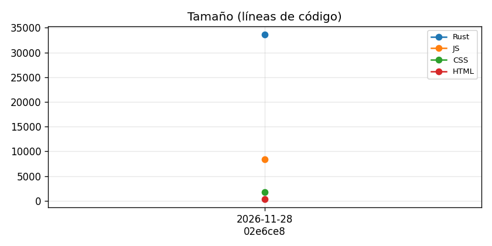
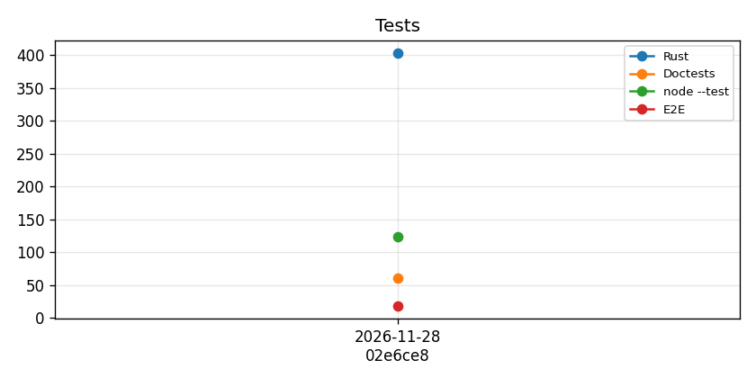
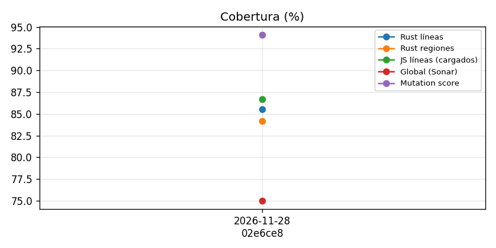
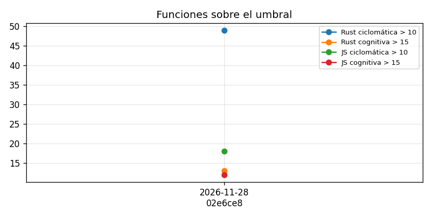
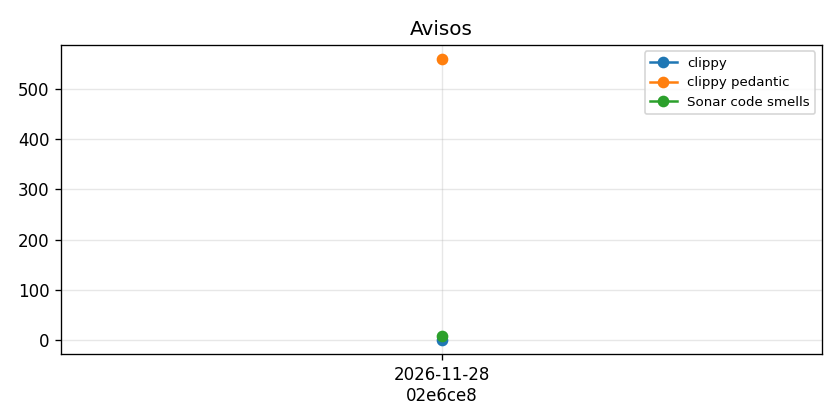
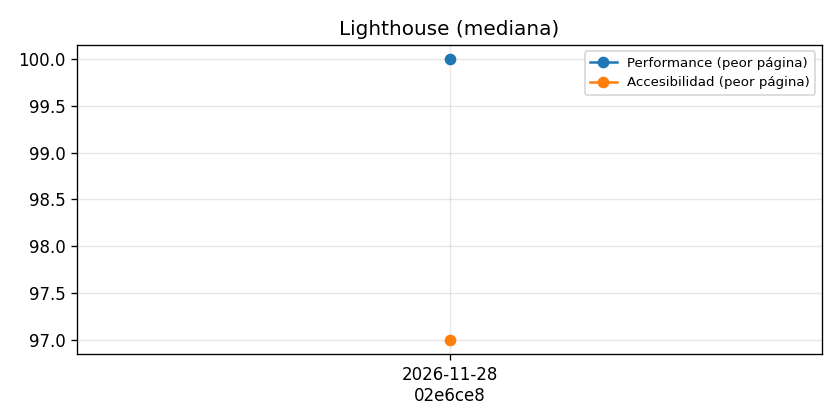

# Medición de calidad — 2026-11-28, `development` en `02e6ce8`

Primera medición (línea base). **Método v1** ([`metodo.md`](metodo.md)). Datos en
[`datos/2026-11-28-02e6ce8/resumen.json`](datos/2026-11-28-02e6ce8/resumen.json), fila en
[`historial.csv`](historial.csv).

- **Commit:** `02e6ce8` — docs(calidad): método de medición y scripts (1/3) (#177).
- **Máquina:** Windows 11 (MINGW64), rustc 1.99.1, Node 24.19.0.
- **Proceso:** desde el inicio del repo (no hay medición anterior).

## Índice

1. [Resumen](#1-resumen)
2. [Contra las referencias](#2-contra-las-referencias)
3. [Hallazgos por característica](#3-hallazgos-por-característica)
4. [Falsos positivos y aceptados](#4-falsos-positivos-y-aceptados)
5. [Recomendaciones](#5-recomendaciones)

## 1. Resumen

| Característica | Estado |
|---|---|
| Tamaño | 33,6 k líneas de Rust, 8,4 k de JS, 1,8 k de CSS. 605 tests: 403 Rust, 60 doctests, 124 `node --test`, 18 flujos E2E. |
| Mantenibilidad | Sin avisos de clippy, 1,9 % de duplicación, nota A con 0,0 % de deuda en Sonar. Puntos débiles: unas pocas funciones muy complejas (sobre todo en `engines.rs`), 19 ciclos entre módulos JS y 35 *exports* sin uso. |
| Fiabilidad | Rust: 85,5 % de líneas y 84,2 % de regiones cubiertas, *mutation score* estimado de 94 %. Huecos: las rutas HTTP casi sin cobertura de tests Rust y 26 de los 31 archivos JS sin tests unitarios (cobertura global de Sonar: 75 %). Sonar: nota C por 26 promesas sin manejar. |
| Seguridad | 4 vulnerabilidades en dependencias Rust con versión corregida disponible. SAST sin hallazgos explotables. Sin *hotspots*. |
| Eficiencia | Lighthouse performance 100 en las tres pantallas. |
| Usabilidad | Lighthouse accesibilidad 97–100; axe sin violaciones en 11 vistas. Sonar marca 2 problemas de etiquetas en `index.html`. |
| Proceso | 71 PRs mergeadas a `development`, mediana de 1,5 h hasta el merge, 96,5 % de las corridas de CI en verde. |

## 2. Contra las referencias

| Indicador | Valor | Referencia | |
|---|---|---|---|
| Funciones con ciclomática > 10 | Rust 49 de 2015, JS 18 de 1254 | 0 (tendencia) | ✗ |
| Funciones con cognitiva > 15 | Rust 13, JS 12 | 0 (tendencia) | ✗ |
| Duplicación (Sonar) | 1,9 % | < 3 % | ✓ |
| Avisos de clippy | 0 (560 con `pedantic`) | tendencia decreciente | ✓ |
| Mantenibilidad / deuda (Sonar) | A / 0,0 % | A / ≤ 5 % | ✓ |
| Dependencias sin uso | Rust 0; JS 0 dependencias, 35 *exports* sin uso | 0 | ~ |
| Ciclos entre módulos JS | 19 | 0 | ✗ |
| Comentarios fuera de la política | 3 archivos | 0 | ✗ |
| `pub fn` del motor sin doctest | 1 | 0 | ✗ |
| Cobertura Rust (líneas / regiones) | 85,5 % / 84,2 % | ≥ 80 % / ≥ 70 % | ✓ |
| Cobertura JS, archivos cargados (líneas / ramas) | 86,7 % / 90,2 % (5 de 31 archivos) | ≥ 80 % / ≥ 70 % | ✓ |
| Cobertura global (Sonar) | 75,0 % | ≥ 80 % | ✗ |
| *Mutation score* del motor | 94,1 % (153 de 771 evaluados) | ≥ 60 % | ✓ |
| Fiabilidad / bugs (Sonar) | C / 27 | A / 0 | ✗ |
| Vulnerabilidades en dependencias | Rust 4, npm 0 | 0 altas / críticas | ✗ |
| SAST sin revisar | 0 (revisados abajo) | 0 | ✓ |
| Seguridad / *hotspots* (Sonar) | A / 0 | A / 0 | ✓ |
| Lighthouse performance (peor pantalla) | 100 | ≥ 90 | ✓ |
| Lighthouse accesibilidad (peor pantalla) | 97 | ≥ 90 | ✓ |
| Violaciones de axe críticas / serias | 0 | 0 | ✓ |

## 3. Hallazgos por característica

### Mantenibilidad

- **Complejidad.** 69 funciones superan algún umbral (50 de Rust y 19 de JS). La complejidad se
  concentra en el motor (`src/computation/engines.rs`), en `src/routes/practice_admin.rs` y en los
  formularios JS (`forms.js`, `lib.js`, `practices-admin.js`). La lista completa está en
  [Funciones sobre los umbrales](#funciones-sobre-los-umbrales).
- **19 ciclos entre módulos JS.** Pasan casi todos por `navigation.js`: importa las vistas y las vistas
  la importan para navegar (`navigation ↔ forms`, `navigation ↔ instruments`,
  `navigation ↔ practices-admin`, `courses → groups → navigation`, …). Hay dos ciclos más chicos:
  `forms-chrono ↔ forms-draft` y `gradebook ↔ students`.
- **35 *exports* sin uso** (knip), 9 de ellos en `forms.js`. Los 3 *unresolved* de knip son falsos
  positivos: son imports dinámicos dentro de `page.evaluate` en los E2E.
- **Clippy `pedantic`:** 560 avisos. Los más frecuentes son `missing_errors_doc` (156),
  `needless_raw_string_hashes` (96), `must_use_candidate` (55) y `too_many_lines` (35). No bloquean;
  quedan como base para ver la tendencia.
- **Política del repo:** `src/practices/mod.rs`, `src/practices/parts.rs` y
  `src/routes/practice_admin.rs` tienen comentarios que no son doctests. Además,
  `validate_student_results` (`src/computation/submission.rs:301`) es `pub fn` del motor y no tiene
  doctest.
- **Sonar en Rust:** analiza 23,3 k líneas (sin `tests.rs`) con el perfil *Sonar way core*
  (58 reglas) y no encuentra problemas.

### Funciones sobre los umbrales

Las 69 funciones que superan algún umbral (50 de Rust y 19 de JS), todas de código
de producción. Se ordenan en dos prioridades.

**Prioridad 1: cognitiva > 15** (25). Son difíciles de leer: tienen anidamiento profundo,
condiciones encadenadas o flujo mezclado. Conviene partirlas en funciones con nombre, con
*early returns* y tablas de datos en vez de cadenas de `if`.

| Función | Ubicación | Ciclomática | Cognitiva |
|---|---|---|---|
| `compute_regresion` | `src/computation/engines.rs:1359` | 52 | 66 |
| `validateMeasurements` | `static/lib.js:626` | 28 | 56 |
| `renderAnalysis` | `static/analysis.js:11` | 23 | 56 |
| `loadSubmissionForm` | `static/forms.js:116` | 44 | 50 |
| `analyze_definition` | `src/computation/engines.rs:2191` | 29 | 50 |
| `check_template` | `src/practices/template.rs:369` | 32 | 43 |
| clausura de `exampleMeasurements` | `static/lib.js:452` | 18 | 34 |
| `run_kind_raw` | `src/computation/engines.rs:2373` | 16 | 32 |
| `build_points` | `src/computation/engines.rs:999` | 18 | 28 |
| `compute_determinations` | `src/computation/engines.rs:725` | 19 | 26 |
| `per_replica_points` | `src/computation/engines.rs:308` | 17 | 25 |
| *handler* de clic de las pestañas | `static/navigation.js:95` | 13 | 24 |
| `renderPracticesPage` | `static/practices-admin.js:341` | 23 | 23 |
| `create_form_submission` | `src/computation/submission.rs:120` | 33 | 20 |
| `restoreChronoDraft` | `static/forms-draft.js:51` | 14 | 20 |
| `compute_quantities` | `src/computation/engines.rs:505` | 11 | 19 |
| clausura `problems` de `dimension_warnings` | `src/routes/practice_admin.rs:422` | 7 | 19 |
| `validate_quantity` | `src/routes/practice_admin.rs:2576` | 20 | 18 |
| clausura de `compareResults` | `static/lib.js:484` | 11 | 18 |
| `goToProblem` | `static/practices-admin.js:1006` | 19 | 17 |
| `derive_results` | `src/computation/engines.rs:2055` | 14 | 17 |
| `measurementRowHtml` | `static/forms.js:387` | 9 | 17 |
| `save_determinations` | `src/routes/practice_admin.rs:1103` | 17 | 16 |
| `fillExampleData` | `static/forms.js:975` | 13 | 16 |
| `collectStandaloneRow` | `static/forms.js:780` | 12 | 16 |

**Prioridad 2: solo ciclomática > 10** (44). Tienen muchas ramas, pero planas: `match` de
despacho, validaciones en secuencia, migraciones. Para bajarlas conviene llevar las ramas a tablas
(`match` → mapa o arreglo de reglas), separar las validaciones en funciones chicas o, en las
migraciones, en un paso por versión.

| Función | Ubicación | Ciclomática | Cognitiva |
|---|---|---|---|
| `migrate` | `src/db/schema.rs:4` | 93 | 4 |
| `function` | `src/computation/dual.rs:184` | 30 | 1 |
| `write_template` | `src/practices/template.rs:581` | 26 | 15 |
| `create_submission` | `src/routes/submissions.rs:70` | 24 | 4 |
| `duplicate_practice` | `src/practices/lifecycle.rs:126` | 20 | 9 |
| `eval_dual` | `src/computation/dual.rs:72` | 19 | 7 |
| `update_form_submission` | `src/computation/submission.rs:410` | 19 | 3 |
| `publish_checked` | `src/practices/versions.rs:245` | 18 | 10 |
| clausura de `normalize` | `src/units.rs:295` | 18 | 2 |
| `parse` | `src/units.rs:244` | 17 | 11 |
| `set_practice_status` | `src/routes/practice_admin.rs:746` | 17 | 11 |
| `preview_definition` | `src/routes/practice_admin.rs:1003` | 17 | 2 |
| `set_section` | `src/routes/practice_admin.rs:3118` | 16 | 13 |
| `main` | `src/main.rs:15` | 16 | 4 |
| `renderQuantityForm` | `static/practices-admin.js:1374` | 14 | 14 |
| `with_updated_quantity` | `src/routes/practice_admin.rs:1226` | 14 | 12 |
| `diff_items` | `src/practices/changes.rs:160` | 14 | 9 |
| `submission_detail` | `src/submissions/mod.rs:700` | 14 | 3 |
| `renderSeriesDebug` | `static/forms-chrono.js:200` | 13 | 12 |
| `submitFormSubmission` | `static/forms.js:868` | 13 | 12 |
| `quantityPayloadFromForm` | `static/practices-admin.js:1676` | 13 | 12 |
| `seed_library` | `src/practices/template.rs:552` | 13 | 6 |
| `walk` | `src/dimensions.rs:93` | 13 | 4 |
| `set_student_results` | `src/routes/submissions.rs:284` | 13 | 2 |
| `check_student_result_symbols` | `src/computation/submission.rs:325` | 12 | 14 |
| `combine` | `src/dimensions.rs:214` | 12 | 12 |
| `seed_instruments` | `src/instruments/seed.rs:6` | 12 | 12 |
| `located_structure_problems` | `src/routes/practice_admin.rs:667` | 12 | 10 |
| `validate_quantity_in` | `src/routes/practice_admin.rs:2642` | 12 | 9 |
| `remove_quantity` | `src/practices/versions.rs:357` | 12 | 5 |
| `update_profile` | `src/routes/auth.rs:123` | 12 | 5 |
| `update_section` | `src/routes/practice_admin.rs:3052` | 12 | 5 |
| `seed_initial_accounts` | `src/db/mod.rs:265` | 12 | 4 |
| `list_changes` | `src/practices/changes.rs:210` | 12 | 4 |
| `delete_quantity` | `src/routes/practice_admin.rs:1313` | 12 | 4 |
| clausura de mapeo de caracteres | `src/dimensions.rs:77` | 12 | 2 |
| `move_guarded` | `src/routes/practice_admin.rs:2940` | 12 | 1 |
| `formula_problems_in` | `src/routes/practice_admin.rs:1975` | 11 | 15 |
| `insert_test_submissions` | `src/db/mod.rs:519` | 11 | 13 |
| `runPracticeAction` | `static/practices-admin.js:272` | 11 | 12 |
| `renderResultForm` | `static/practices-admin.js:1494` | 11 | 11 |
| `roleFlags` | `static/lib.js:377` | 11 | 7 |
| `definition_in` | `src/practices/crud.rs:28` | 11 | 1 |
| `update_result` | `src/routes/practice_admin.rs:2399` | 11 | 0 |

### Fiabilidad

- **Cobertura Rust por archivo:** la lógica está bien cubierta; los huecos están en los *handlers*
  HTTP. `src/main.rs` y `src/routes/auth.rs` tienen 0 %, `src/routes/submissions.rs` 2,4 %,
  `src/routes/courses.rs` 3,1 %, `src/routes/instruments.rs` 41 % y `src/routes/mod.rs` 48 %. Esos
  caminos los recorren los E2E, que no suman a la cobertura.
- **Cobertura JS:** `node --test` carga solo 5 de los 31 archivos de `static/` (`lib.js`,
  `chronometer.js`, `state.js`, `forms-shared.js`, `analysis-plots.js`), con buena cobertura. Sonar,
  que cuenta 0 % para el resto, da 75 % global (74,6 % de líneas).
- **Mutantes:** se evaluaron 173 de 771 en las 2 h (muestra al azar): 144 detectados, 9 no
  detectados, 8 por *timeout* y 12 no viables. Los no detectados:
  - `create_form_submission` (`src/computation/submission.rs:129` y `:149`): una negación y dos
    comparaciones.
  - `compute_regresion` (`src/computation/engines.rs:1808`): `||` y `<`.
  - `extreme` y `arguments` (`src/computation/dual.rs:179` y `:147`).
  - `RunU::checked` (`src/computation/engines.rs:198`): `&=`.
  - `scale_type_b` (`src/computation/engines.rs:104`): `*`.
- **Sonar, bugs (27, ninguno de impacto alto):**
  - **26 × S9383 (promesas sin manejar):** llamadas `async` sin `await` ni `.catch`, sobre todo en
    `navigation.js` (12), `forms.js` (6) y `practices-admin.js` (5). Un error en esas llamadas queda
    como *unhandled rejection* sin aviso al usuario.
  - **1 × campo sin etiqueta** en `static/index.html:291`: el `<input type="file">` oculto para
    importar prácticas.

### Seguridad

- **Dependencias Rust con vulnerabilidades** (todas transitivas, todas con versión corregida):

  | Aviso | Crate | Problema | Corregida en |
  |---|---|---|---|
  | RUSTSEC-2026-0459 | `libsqlite3-sys` 0.30.1 | CVE del SQLite embebido | ≥ 0.39.0 |
  | RUSTSEC-2023-0071 | `rsa` 0.9.10 | Marvin Attack (canal lateral de tiempo) | ≥ 0.10.0 |
  | RUSTSEC-2026-0592 | `url` 2.5.4 | *Stack overflow* en `Url::origin()` | ≥ 2.5.9 |
  | RUSTSEC-2026-0381 | `webpki-roots` 1.0.7 | Raíces desconfiadas de emSign | ≥ 1.0.10 |

  `rsa` está en `Cargo.lock` por `sqlx-mysql`, pero no se compila (`cargo tree -i rsa` no lo
  muestra): cargo-audit lee el lockfile entero. Las otras se resuelven actualizando `Cargo.lock` y,
  para `libsqlite3-sys`, `sqlx`. Hay además 7
  avisos no de seguridad: 2 crates sin mantenimiento (`chrono`, `pin-utils`), 4 *unsound* (`anyhow`,
  `event-listener`, `rustix`, `tokio`) y 1 versión retirada (`spin`).
- **CodeQL Rust:** 26 avisos de "valor criptográfico fijo". 23 son contraseñas y claves de los tests
  en línea, y 3 las contraseñas de la siembra demo (`src/db/mod.rs:313–353`), que solo se usan con
  `SEED_DEMO_DATA=true`. A eso se suma 1 "almacenamiento en texto plano" en un test
  (`src/db/mod.rs:794`). Ninguno es explotable.
- **CodeQL JS:** 6 variables sin uso en `static/` (calidad, no seguridad) y 1 saneamiento incompleto
  en `tests/e2e/lib.mjs:112` (código de test).
- **Semgrep:** 3 avisos de `insertAdjacentHTML` (`forms-series.js:88`, `forms.js:1222`,
  `magnitudes.js:11`). El HTML sale de plantillas propias con `escapeHtml` en los valores, así que no
  hay XSS.
- **Sonar:** 0 vulnerabilidades y 0 *security hotspots*.

### Eficiencia y usabilidad

| Pantalla | Performance | Accesibilidad | Buenas prácticas | SEO |
|---|---|---|---|---|
| Login | 100 | 97 | 96 | 90 |
| Estudiante, vista inicial | 100 | 100 | 100 | 90 |
| Docente, vista inicial | 100 | 100 | 100 | 90 |

axe no encontró violaciones WCAG 2.1 AA en login, la vista inicial del estudiante ni en las 9 vistas
del docente. Sonar marca 2 problemas de etiquetas en `static/index.html`, ambos en elementos ocultos:
el `<label class="hidden">` del selector de práctica (`:90`) y el input de archivo de importación
(`:291`).

### Proceso

71 PRs mergeadas a `development` desde el inicio, con una mediana de 1,5 h hasta el merge y 56 k
líneas cambiadas. De 684 corridas completas de CI, el 96,5 % terminó en verde.

## 4. Falsos positivos y aceptados

Marcados en la instancia local de Sonar (solo existen ahí):

- **S2189, `static/forms.js:1221` → falso positivo.** Sonar dice que el bucle `while` no termina
  porque `group` no cambia, pero `inputs` se vuelve a consultar en cada vuelta y crece con cada
  `insertAdjacentHTML`, así que el bucle termina.

Revisados y no marcados (no son de Sonar): los hallazgos de CodeQL y Semgrep de §3, que no son
explotables.

## 5. Recomendaciones

Ordenadas por relación entre beneficio y esfuerzo. Son candidatas para el PR 3/3 del plan.

1. **Actualizar dependencias Rust** (`cargo update`, revisar `sqlx`) para cerrar 3 de las 4
   vulnerabilidades. La de `rsa` no afecta al binario, pero sigue apareciendo mientras
   `sqlx-mysql` esté en el lockfile.
2. **Manejar las promesas sueltas** (S9383): un `.catch` que muestre el error con el *toast* existente,
   empezando por `navigation.js`. Saca a Sonar de la nota C.
3. **Cumplir la política del repo:** `python scripts/comments.py --fix` en los 3 archivos y un doctest
   para `validate_student_results`.
4. **Tests de integración de las rutas HTTP** (`auth`, `submissions`, `courses`) con el router en
   memoria (`tower::ServiceExt::oneshot`, como ya hace `routes/practice_admin.rs`). Es donde más
   baja la cobertura Rust.
5. **Romper los ciclos de `navigation.js`:** que las vistas se registren en la navegación en vez de que
   la navegación las importe. También borrar los 35 *exports* sin uso.
6. **Bajar la complejidad de las 69 funciones de
   [Funciones sobre los umbrales](#funciones-sobre-los-umbrales)**, en dos tandas:
   - **Primero las 25 de cognitiva > 15.** Empezar por el motor (`compute_regresion`,
     `analyze_definition`, `run_kind_raw`, `build_points`, `compute_determinations`,
     `per_replica_points`, …) y los formularios JS (`validateMeasurements`, `renderAnalysis`,
     `loadSubmissionForm`, …).
   - **Después las 44 que solo superan la ciclomática**, llevando las ramas a tablas o a validaciones
     chicas.

   Antes de partir cada función del motor, agregar los tests que maten sus mutantes no detectados
   (§3, Fiabilidad), así el refactor queda cubierto. Una PR por archivo o grupo de funciones
   relacionadas.
7. **Etiquetas de `index.html`** (`:90` y `:291`).
